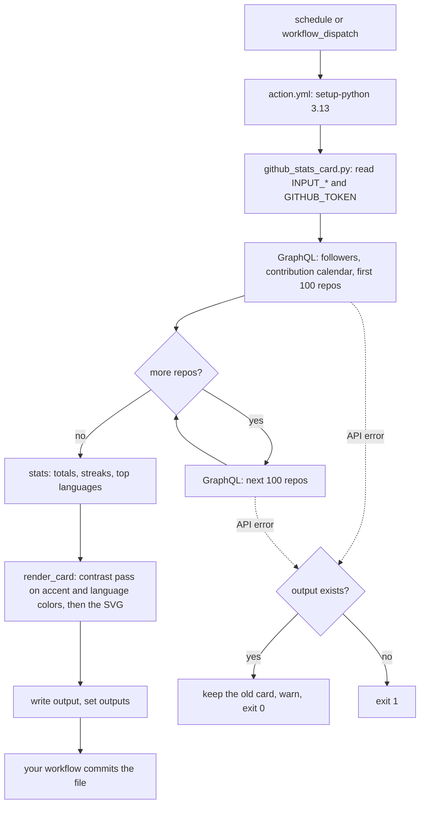

# Self-hosted GitHub Stats Card

[](https://github.com/Sagargupta16/github-stats-card-action/actions/workflows/ci.yml)
[](https://github.com/Sagargupta16/github-stats-card-action/releases/latest)
[](https://github.com/marketplace/actions/self-hosted-github-stats-card)
[](LICENSE)

A GitHub Action that renders an animated GitHub stats card as an SVG file in your own repo, so your profile README never depends on a hosted widget.



Live data for [@Sagargupta16](https://github.com/Sagargupta16), rendered on 2026-10-11.

Public stats-widget hosts serve everyone from shared API quotas, and when a quota runs out your README shows an error instead of your stats. This action renders the card in your own workflow, with your own token, and commits a plain file that GitHub serves like any other file in your repo.

Install it from the GitHub Marketplace: [Self-hosted GitHub Stats Card](https://github.com/marketplace/actions/self-hosted-github-stats-card).

## Quick start

Add `.github/workflows/github-stats.yml` to the repo whose README shows the card (for a profile README, that is the `<username>/<username>` repo):

```yaml
name: GitHub stats card

on:
  schedule:
    - cron: "0 6 * * *" # daily at 06:00 UTC
  workflow_dispatch:

permissions:
  contents: write

jobs:
  card:
    runs-on: ubuntu-latest
    steps:
      - uses: actions/checkout@v7

      - uses: Sagargupta16/github-stats-card-action@v1

      - name: Commit the card if it changed
        run: |
          git config user.name "github-actions[bot]"
          git config user.email "41898282+github-actions[bot]@users.noreply.github.com"
          git add assets/github-stats.svg
          if ! git diff --cached --quiet; then
            git commit -m "chore: refresh github stats card"
            git push
          fi
```

Run it once from the Actions tab so the file exists, then embed it.

The job gets a `contents: write` token, so for the strictest supply-chain setup pin a full commit SHA instead of the moving `v1` tag, and let Renovate or Dependabot bump it:

```yaml
      - uses: Sagargupta16/github-stats-card-action@4a7221cb12bbfb6e89d97c7a2623b60596bf105e # v1.1.0
```

## Embed

```html

```

The card is 840 px wide and scales down with `width="100%"`.

## Inputs

| Input | Default | Description |
| --- | --- | --- |
| `username` | `${{ github.repository_owner }}` | GitHub user to render |
| `token` | `${{ github.token }}` | Token for the GraphQL API. The default is enough; see [Limits](#limits) |
| `output` | `assets/github-stats.svg` | Path of the SVG, relative to the workspace. Missing folders are created |
| `accent` | `#60a5fa` | Hex color (`#rrggbb` or `rrggbb`) for the title and the contribution calendar. A color too dark to read on the card is lightened to the nearest shade that reaches 4.5:1. Quote it in YAML, where `#` starts a comment: `accent: "#f59e0b"` |
| `title` | `GITHUB \| @<USERNAME>` | Card title, rendered as given |
| `languages` | `6` | How many top languages to show, three per legend row. Past six, the card grows 20 px per extra row |
| `exclude-repos` | empty | Comma-separated repository names (`name` or `owner/name`, case-insensitive) left out of stars and languages |

## Outputs

| Output | Description |
| --- | --- |
| `contributions` | Contributions in the last year |
| `streak` | Current streak, in days |
| `stars` | Stars across the counted repositories |

All three are empty when the API call failed and the previous card was kept.

## Why not a hosted widget

| | Shared hosted instance | This action |
| --- | --- | --- |
| API quota | One pool shared by every user of the instance | Your own workflow token |
| When a README is viewed | The instance calls the GitHub API (or serves its cache) | GitHub serves a committed file; no API call |
| When the API fails | The card fails to render | The old card stays, the run warns and exits 0 |
| Runtime dependency | The host has to be up on every view | None after the commit |

[github-readme-stats](https://github.com/anuraghazra/github-readme-stats), the hosted widget with about 80k stars, says this in its own README: "The public Vercel instance [...] is best-effort and can be unreliable due to rate limits and traffic spikes". It recommends self-hosting or generating cards in a GitHub Actions workflow instead, which is what this action does.

## How it works



1. The script queries the GitHub GraphQL API for the user's followers, contribution calendar and totals for the last year, and the public, non-fork repositories they own with their stars and top 10 languages by size, 100 repositories per request.
2. It renders the card: five stat tiles; the contribution calendar, one column per week, fading in left to right; current streak, longest streak and active days; and a stacked bar of the top languages by code size, with a legend.
3. It writes the SVG to `output` and sets the outputs. Your workflow commits the file.

Details:

- Calendar shades are quartiles of your own non-zero days, so the brightest cells are your busiest quarter of active days rather than a fixed count.
- Text and data colors meet WCAG contrast on the card: text reaches 4.5:1, and each calendar level and language swatch reaches 3:1 (WCAG 1.4.11). The four calendar levels are solid shades from a deep blue (or a deep shade of your accent) up to the accent; empty days are a faint tint. A language color from GitHub that is too dark for the card, such as CSS purple, is drawn at the nearest lighter shade of the same hue.
- When today has no contributions yet, the streak counts back from yesterday, so an early run does not reset it.
- If the API call fails and `output` already exists, the action keeps the old card, prints a warning and exits 0, so an outage never blanks your README. If there is no card yet, it exits 1.
- The SVG is self-contained: no scripts, no external fonts or images, CSS and SMIL animation only. Every string you pass in and every name from the API is HTML-escaped.
- The script is Python standard library only, and it connects to `https://api.github.com/` and nothing else.

## Design decisions

- **Composite action, standard library only.** There is no Docker image to pull, no `node_modules` or bundled `dist/` to commit, and no install step, so a third-party release can never break a consumer's run. The whole action is `action.yml` plus one script.
- **A committed file instead of a hosted endpoint.** A README view never reaches the GitHub API. Each run costs one GraphQL request, plus one more per extra 100 repositories.
- **One allowed host.** `fetch` refuses any URL outside `https://api.github.com/` before it opens a connection, so the token can only go to GitHub.
- **Keep the old card or exit.** An API error or a mistyped username leaves the existing card in place with a warning and exit 0. A first run with nothing to keep exits 1, so a broken setup is visible.
- **Quartile shading.** Calendar levels are cut at the quartiles of your own non-zero days, so the brightest level is always your busiest quarter of active days, whether a busy day for you means 3 contributions or 30. Fixed thresholds would leave a quiet profile all one shade.
- **Contrast floors, not hand-picked colors.** The accent and every language color go through `ensure_contrast`, which raises a color's lightness, keeping its hue, until it reaches 4.5:1 for text or 3:1 for graphics. Any accent and any color GitHub returns stay readable.

## Limits

- Private contributions show up only if the user has turned on "Include private contributions on my profile" in their GitHub profile settings. The default `GITHUB_TOKEN` sees public data.
- Stars and languages count public, non-fork repositories the user owns, whichever token you pass. Organization repositories are left out.
- Contributions cover GitHub's rolling last-year calendar, not the calendar year.
- Languages are ranked by bytes of code, summed over the top 10 languages GitHub detects in each repository.
- github.com only; GitHub Enterprise Server is not supported.
- The card names its fonts with system fallbacks instead of embedding them, so text widths vary slightly between viewers.
- The card is a fixed 840 px layout that scales down as a whole. Shown 360 px wide, it draws at 43% size: the 8 px tile labels come out under 3.5 px and the 22 px values about 9.4 px, so the small labels are hard to read on a phone.
- The action runs `actions/setup-python` with Python 3.13 in your job, and that Python stays first on `PATH` for the steps after it. If a later step needs another version, give it its own `setup-python` step.

## License

[MIT](LICENSE)
